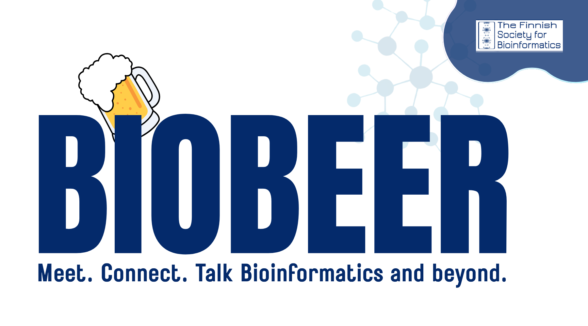
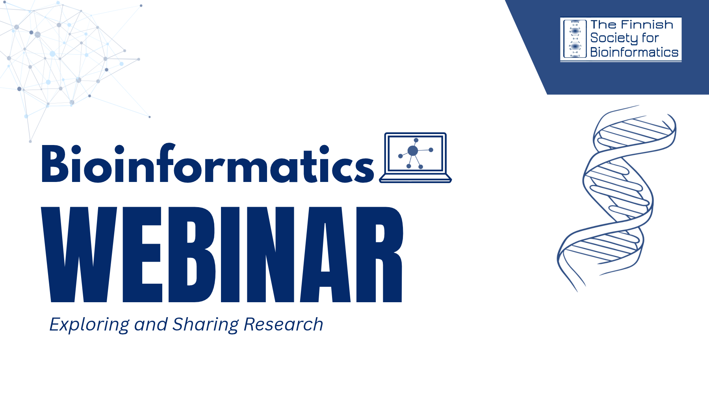

::::: {.grid}

<!-- First event -->

:::: {.g-col-12 .g-col-md-6}

{.img-fluid}

::::

:::: {.g-col-12 .g-col-md-6}

<!-- {.mt-0} is needed to align the image with the title-->

## The BioBeers {.mt-0}

BioBeers are local and casual Bioinformaticians get-togethers.

```{r}
#| echo: false
#| results: asis

source("../R/render-events.R")

cat(render_events("../data/events.yaml", type = "biobeers"))
```

Helsinki BioBeers aims to try different restaurants and bars at each BioBeer.
Suggest a place for the next Helsinki BioBeer
[**here**](https://link.webropolsurveys.com/S/54EAE005F8199416).

::::

<!-- Second event -->

:::: {.g-col-12 .g-col-md-6 .text-center}

{.img-fluid}

::::

:::: {.g-col-12 .g-col-md-6}

## The BioWebinar {.mt-0}

```{r}
#| echo: false
#| results: asis

source("../R/render-events.R")

cat(render_events("../data/events.yaml", type = "webinars"))
```

::: {.d-flex .gap-2}

[Read the abstract](bioinformatics-webinars.qmd){.btn .btn-dark .rounded-pill}

[Sign up for the webinar](https://tuni.zoom.us/meeting/register/XmbaHI2YQsuET8nMZDi2nQ){.btn
.btn-dark .rounded-pill target="_blank"}

:::

::::

:::::

::: {.text-center .mt-5}

## Frequently Asked Questions

:::

::::: {.grid}

:::: {.g-col-12 .g-col-md-6}

### What is the BioBeer about?

We organize BioBeer to offer bioinformaticians and everyone interested in
Bioinformatics a possibility to network with like-minded people. It's a great
opportunity to talk about bioinformatics or just come and meet new people and
old friends.

::::

:::: {.g-col-12 .g-col-md-6}

### What are the BioWebinars about?

We organize BioWebinars for our members and for everyone interested in
Bioinformatics as part of our goal to support bioinformatics research, share the
latest scientific discoveries, and provide opportunities for exchanging ideas
and knowledge, thus spread open knowledge in bioinformatics.

::::

:::: {.g-col-12 .g-col-md-6}

### Do I get free food and drinks at the BioBeer events?

Unfortunately the society cannot (afford to) offer free food and drinks at the
BioBeers. However, it is not required to buy anything at the BioBeer events,
just come along to meet like minded people! And there is always free water
available at the restaurants and bars.

::::

:::: {.g-col-12 .g-col-md-6}

### Who can participate in the webinar?

The webinar is aimed for all bioinformaticians and everyone interested in
bioinformatics. If you know someone interested in bioinformatics or in the topic
of a specific webinar, you can share the webinar link with them. Our webinar
link is always the same.

::::

:::: {.g-col-12 .g-col-md-6}

### Why there is no BioBeer event in my town?

Currently we organize BioBeer events only in Turku, Helsinki, Tampere, and Oulu
because of more active Bioinformatics community in these cities. If you would
like to start organize BioBeer events in your town, please contact us by email:
[fsfbioinf@gmail.com](mailto:fsfbioinf@gmail.com) and we will help you with
everything to set up the events!

::::

:::: {.g-col-12 .g-col-md-6}

### How do you select your speakers?

We aim to have variety in our speakers so they come from all career stages,
different fields of bioinformatics and from all corners of the world. For
late-career stage researcher we have reserved a full hour of presentation and
questions (usually 45+15 minutes), while two younger researchers often share one
webinar (25+5 minutes each).

::::

:::: {.g-col-12 .g-col-md-6}

### How can I present my work at the BioWebinar?

We would be thrilled to hear about your work in our Bioinformatics webinars! If
you would like to present your work at the Bioinformatics webinar, please
contact us by email [fsfbioinf@gmail.com](mailto:fsfbioinf@gmail.com) and we
will try to get your talk lined up for the next available slot.

::::

:::::
